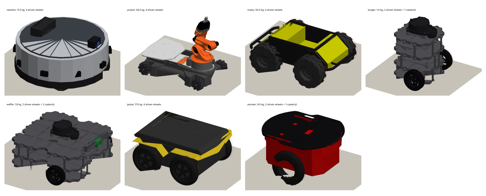

# terrasim

**Wheel-terrain interaction (terramechanics) for Gazebo Harmonic: traction and slip, sinkage, motor currents and
energy of wheeled robots on floors and soils.**

English | [Русский](README.ru.md)



terrasim is a research simulator. A header-only C++ core computes the contact of every wheel with the ground
(Janosi shear traction, rolling losses, an optional Bekker soft layer, spatially heterogeneous surfaces), DC motors
with their controllers, wheel encoders and an IMU. A Gazebo Harmonic system plugin applies these forces to the robot,
and an offline emulator runs the same code without Gazebo. Everything that defines a run — surfaces, robots, terrain
maps — is plain JSON / YAML, so you can add your own and calibrate them against your own data.

## Features

* **Contact model** for omni, mecanum, ordinary and caster wheels: traction–slip law, rolling resistance of wheels and
  rollers, soft layers (carpet pile, foam, sand, loam, clay, Mars soil) with sinkage and compaction resistance,
  heterogeneity fields along the ground ([physics](docs/en/PHYSICS.md)).
* **Surface libraries**: 18 floors and soils (4 calibrated on a real Festo Robotino, 14 from handbook and literature
  values) and 27 surfaces for tyres (asphalt, gravel, grass, snow, ice, soils; 6 of them fitted on recorded runs of a
  real Clearpath Husky) ([surfaces](docs/en/SURFACES.md)).
* **8 robots**: Robotino, KUKA youBot, Clearpath Husky and Jackal, TurtleBot3 Burger and Waffle Pi, Pioneer 3-DX and a
  MarsSim rocker-bogie rover; your own robot is one JSON file ([robots](docs/en/ROBOTS.md)).
* **31 terrain maps** (slopes, bumps, craters, ditches, dunes, surface mosaics) with ready-made scenarios and a
  documented YAML format for your own ([maps](docs/en/MAPS.md)).
* **Falls and rollovers**: the body touches the ground, so robots scrape their bellies on bumps, fall off edges and roll
  over; a run stops when the robot tips over or goes on (`--on-tip continue`) ([physics](docs/en/PHYSICS.md#27-body-ground-contact-falls-and-rollovers)).
* **Sandbox runs**: trajectories, open or closed loop on the true pose, wheel odometry or odometry + IMU, motor
  currents, slip, sinkage, energy; one log, figure and metric set per run, batches in parallel ([running](docs/en/RUNNING.md)).
* **Synthetic Robotino datasets** in the format of real lab recordings, clean and through a measurement model
  ([datasets](docs/en/DATASETS.md)).
* **ROS 2 topics** of a running simulation, including currents, slip and sinkage ([ROS 2](docs/en/ROS2.md)).

## Requirements

* Ubuntu 24.04, Gazebo Harmonic (gz-sim 8) — for the Gazebo engine;
* g++ (C++17), CMake ≥ 3.16;
* Python ≥ 3.10 with numpy, pandas, matplotlib, scipy, PyYAML, tabulate (`requirements.txt`);
* optional: ROS 2 Jazzy for topics and launch files.

The emulator (`--engine emulate`) needs only the compiler and Python, so it also works on other Linux systems.

## Installation

```bash
git clone https://github.com/<your-account>/terrasim.git ~/terrasim
cd ~/terrasim
bash scripts/install_deps.sh        # build tools, Python packages, Gazebo Harmonic if it is missing (sudo)
bash scripts/build.sh core          # core, emulator and unit tests (no Gazebo needed)
bash scripts/build.sh harmonic      # + the Gazebo Harmonic plugin
```

The ROS 2 launch files assume the clone is in `~/terrasim`; elsewhere, call them by their full path.

> Simulation outputs go to `runs_drive/`, `runs/` and `datasets/` inside the project (ignored by git). If you ever
> reinstall by deleting the folder (`rm -rf ~/terrasim`), they are deleted too: keep data you need outside the project
> or pass `--out` with a path outside it.

## Quick start

```bash
bash scripts/drive.sh --list                                          # robots, surfaces, trajectories, maps
# Husky on a mosaic of sand and gray rubber, rounded square, emulator (seconds)
bash scripts/drive.sh --robot husky --floor "voronoi:surfaces=gray+sand_lete,cell=2" --traj square:L=4,rc=0.6
# the same in Gazebo with a window
bash scripts/drive.sh --engine harmonic --gui --robot husky --floor "voronoi:surfaces=gray+sand_lete,cell=2" --traj square:L=4,rc=0.6
# every robot up a 15° slope
bash scripts/drive.sh --map slope_15@up
# Robotino star experiment on carpet -> dataset
bash scripts/robotino.sh --engine emulate --surfaces carpet --speeds 0.2
```

Each run writes `figure.png`, `log.csv`, `full.csv.gz` and `metrics.json`; a batch adds `summary.csv` ([outputs](docs/en/OUTPUTS.md)).

## Make it yours

**Start here: [EXAMPLES](docs/en/EXAMPLES.md)** — tested commands to copy, and step-by-step walkthroughs for your own
robot, surface and map, with ready files in [`examples/`](examples).

| you want to | do | guide |
|---|---|---|
| add a surface | a JSON file with `"base"` + changed parameters, `--surface-file my.json` | [SURFACES](docs/en/SURFACES.md#4-adding-your-own-surface) |
| change a robot | `--set robot.mass=70 --set motor.gear=50`, or `configs/robots/<name>.json` with `"base": "husky"` | [ROBOTS](docs/en/ROBOTS.md#2-changing-parameters-of-a-robot) |
| add a robot | `configs/robots/<name>.json` (copy of `examples/robots/my_diffbot.json` or `my_skidsteer.json`) | [EXAMPLES](docs/en/EXAMPLES.md#3-your-own-robot-step-by-step) |
| add a terrain map | copy `examples/maps/my_first_map.yaml` to `configs/maps/`, edit the YAML | [EXAMPLES](docs/en/EXAMPLES.md#5-your-own-map-step-by-step) |
| compare with your recordings | replay recorded commands (`--replay`), compare `log.csv` | [RUNNING](docs/en/RUNNING.md#6-replaying-recorded-commands) |

## Documentation

| | English | Русский |
|---|---|---|
| **Examples: commands to copy, your own robot / surface / map step by step** | [EXAMPLES](docs/en/EXAMPLES.md) | [EXAMPLES](docs/ru/EXAMPLES.md) |
| How it works: contact model, motors, engines | [PHYSICS](docs/en/PHYSICS.md) | [PHYSICS](docs/ru/PHYSICS.md) |
| Surfaces: parameters, library, your own | [SURFACES](docs/en/SURFACES.md) | [SURFACES](docs/ru/SURFACES.md) |
| Robots: parameters, `--set`, your own robot | [ROBOTS](docs/en/ROBOTS.md) | [ROBOTS](docs/ru/ROBOTS.md) |
| Maps: catalogue, format, your own map | [MAPS](docs/en/MAPS.md) | [MAPS](docs/ru/MAPS.md) |
| Running: options, trajectories, control, IMU | [RUNNING](docs/en/RUNNING.md) | [RUNNING](docs/ru/RUNNING.md) |
| Outputs: logs, columns, metrics | [OUTPUTS](docs/en/OUTPUTS.md) | [OUTPUTS](docs/ru/OUTPUTS.md) |
| Synthetic Robotino datasets | [DATASETS](docs/en/DATASETS.md) | [DATASETS](docs/ru/DATASETS.md) |
| ROS 2 topics and launch files | [ROS2](docs/en/ROS2.md) | [ROS2](docs/ru/ROS2.md) |

## Repository layout

```
core/include/terramech/   header-only C++17 core: contact, motors, sensors, robot logic
core/src, core/tests      C API for Python, planar Robotino, the 3D emulators, unit tests
gz_harmonic/              Gazebo Harmonic system plugin
tools/                    Python: runners, maps, robots, figures, dataset export
scripts/                  install, build and run scripts
ros2/                     ROS 2 launch files and the topic bridge
configs/                  calibrated_params.json (Robotino, rover, base surface library), surfaces_husky.json,
                          maps/ (31 maps + template), robots/ (your robot files)
examples/                 ready robot files, a map, a surface file and a command recording to start from
models/meshes/            robot meshes (own licences: models/meshes/SOURCES.md)
docs/                     guides (en, ru), map and robot pictures
```

## Testing

```bash
bash scripts/build.sh core           # also runs the unit tests of the core
python3 tools/test_maps.py           # map format, relief, zones, scenarios
python3 tools/test_replay.py         # command replay
python3 tools/test_body.py           # body-ground contact: flat ground, rollover, rest on the roof
python3 tools/drive_validate.py      # the vehicle mode reproduces the Robotino star experiment
bash scripts/drive_examples.sh       # 9 example studies in the emulator
```


## Licence

MIT, see [`LICENSE`](LICENSE). The robot meshes in `models/meshes/` keep the licences of their sources
([`models/meshes/SOURCES.md`](models/meshes/SOURCES.md)); the youBot meshes, for example, are GPLv3.

## Acknowledgements

The rover model and the MarsSim soil follow Zhou et al., MarsSim (2023). Soil parameters come from J. Y. Wong,
*Theory of Ground Vehicles*. Robot geometry comes from the public description packages of ROBOTIS, Clearpath Robotics,
KUKA / Locomotec and the Pioneer 3-DX community package.
