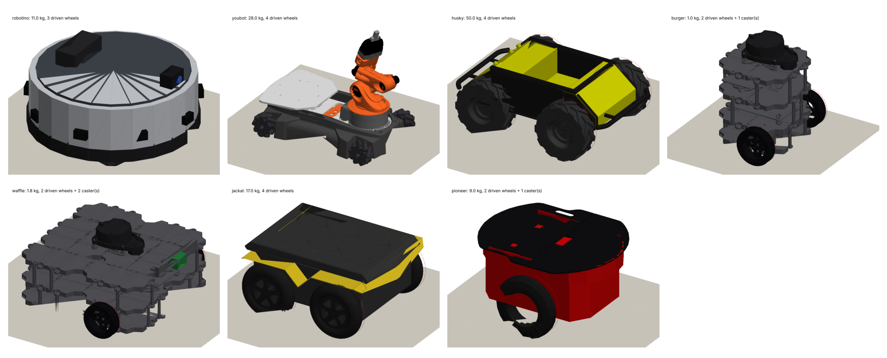

# terrasim

**Взаимодействие колеса с грунтом (терромеханика) для Gazebo Harmonic: тяга и проскальзывание, осадка, токи моторов и
энергия колёсных роботов на покрытиях и грунтах.**

[English](README.md) | Русский



terrasim — исследовательский симулятор. Ядро на C++ (только заголовки) считает контакт каждого колеса с землёй (тяга
по закону сдвига Яноши, потери на качение, мягкий слой Беккера по желанию, пространственно неоднородные поверхности),
моторы постоянного тока с регуляторами, энкодеры колёс и IMU. Системный плагин Gazebo Harmonic прикладывает эти силы к
роботу, а офлайн-эмулятор выполняет тот же код без Gazebo. Всё, что определяет прогон — поверхности, роботы, карты
рельефа, — обычные файлы JSON / YAML: можно добавлять свои и калибровать их по своим данным.

## Возможности

* **Модель контакта** для омни-, меканум-, обычных колёс и опор: закон тяга–скольжение, сопротивление качению колёс и
  роликов, мягкие слои (ворс, пена, песок, супесь, глина, марсианский грунт) с осадкой и сопротивлением уплотнению,
  поля неоднородности вдоль земли ([физика](docs/ru/PHYSICS.md)).
* **Библиотеки поверхностей**: 18 покрытий и грунтов (4 откалиброваны на реальном Festo Robotino, 14 построены по
  справочным и литературным данным) и 27 поверхностей для шин (асфальт, гравий, трава, снег, лёд, грунты; 6 из них
  подобраны по записям реального Clearpath Husky) ([поверхности](docs/ru/SURFACES.md)).
* **8 роботов**: Robotino, KUKA youBot, Clearpath Husky и Jackal, TurtleBot3 Burger и Waffle Pi, Pioneer 3-DX и ровер
  MarsSim с подвеской «коромысло–тележка»; свой робот — это один JSON-файл ([роботы](docs/ru/ROBOTS.md)).
* **31 карта рельефа** (склоны, кочки, кратеры, канавы, дюны, мозаики покрытий) с готовыми заездами и описанным форматом
  YAML для своих ([карты](docs/ru/MAPS.md)).
* **Падения и опрокидывания**: корпус касается земли, поэтому роботы садятся брюхом на кочки, падают с уступов и
  переворачиваются; прогон останавливается при опрокидывании или идёт дальше (`--on-tip continue`)
  ([физика](docs/ru/PHYSICS.md#27-контакт-корпуса-с-землёй-падения-и-опрокидывания)).
* **Прогоны в песочнице**: траектории, без регулятора или с регулятором по истине, одометрии колёс или одометрии + IMU;
  токи моторов, проскальзывание, осадка, энергия; по каждому прогону лог, рисунок и метрики, пакеты параллельно
  ([запуск](docs/ru/RUNNING.md)).
* **Синтетические датасеты Robotino** в формате реальных лабораторных записей, чистые и через модель измерений
  ([датасеты](docs/ru/DATASETS.md)).
* **Топики ROS 2** идущей симуляции, включая токи, проскальзывание и осадку ([ROS 2](docs/ru/ROS2.md)).

## Требования

* Ubuntu 24.04, Gazebo Harmonic (gz-sim 8) — для движка Gazebo;
* g++ (C++17), CMake ≥ 3.16;
* Python ≥ 3.10 с numpy, pandas, matplotlib, scipy, PyYAML, tabulate (`requirements.txt`);
* по желанию: ROS 2 Jazzy для топиков и launch-файлов.

Эмулятору (`--engine emulate`) нужны только компилятор и Python, поэтому он работает и на других Linux.

## Установка

```bash
git clone https://github.com/<ваш-аккаунт>/terrasim.git ~/terrasim
cd ~/terrasim
bash scripts/install_deps.sh        # сборка, пакеты Python, Gazebo Harmonic, если его нет (sudo)
bash scripts/build.sh core          # ядро, эмулятор и тесты (Gazebo не нужен)
bash scripts/build.sh harmonic      # + плагин Gazebo Harmonic
```

Launch-файлы ROS 2 рассчитаны на копию в `~/terrasim`; если проект в другом месте, вызывайте их по полному пути.

> Результаты симуляций пишутся в `runs_drive/`, `runs/` и `datasets/` внутри проекта (git их игнорирует). Если
> переустанавливать проект удалением папки (`rm -rf ~/terrasim`), они удалятся вместе с ней: нужные данные храните вне
> проекта или задавайте `--out` с путём снаружи.

## Быстрый старт

```bash
bash scripts/drive.sh --list                                          # роботы, поверхности, траектории, карты
# Husky на мозаике из песка и серой резины, квадрат со скруглёнными углами, эмулятор (секунды)
bash scripts/drive.sh --robot husky --floor "voronoi:surfaces=gray+sand_lete,cell=2" --traj square:L=4,rc=0.6
# то же в Gazebo с окном
bash scripts/drive.sh --engine harmonic --gui --robot husky --floor "voronoi:surfaces=gray+sand_lete,cell=2" --traj square:L=4,rc=0.6
# все роботы вверх по склону 15°
bash scripts/drive.sh --map slope_15@up
# «звезда» Robotino на ковролине -> датасет
bash scripts/robotino.sh --engine emulate --surfaces carpet --speeds 0.2
```

Каждый прогон пишет `figure.png`, `log.csv`, `full.csv.gz` и `metrics.json`; пакет добавляет `summary.csv`
([результаты](docs/ru/OUTPUTS.md)).

## Под свои задачи

**Начните отсюда: [EXAMPLES](docs/ru/EXAMPLES.md)** — проверенные команды, которые можно копировать, и разбор по шагам:
свой робот, своя поверхность, своя карта; готовые файлы лежат в [`examples/`](examples).

| хочу | как | руководство |
|---|---|---|
| добавить поверхность | JSON-файл с `"base"` + изменёнными параметрами, `--surface-file my.json` | [SURFACES](docs/ru/SURFACES.md#4-своя-поверхность) |
| изменить робота | `--set robot.mass=70 --set motor.gear=50` или `configs/robots/<имя>.json` с `"base": "husky"` | [ROBOTS](docs/ru/ROBOTS.md#2-как-поменять-параметры-робота) |
| добавить робота | `configs/robots/<имя>.json` (копия `examples/robots/my_diffbot.json` или `my_skidsteer.json`) | [EXAMPLES](docs/ru/EXAMPLES.md#3-свой-робот-по-шагам) |
| добавить карту | скопировать `examples/maps/my_first_map.yaml` в `configs/maps/`, отредактировать YAML | [EXAMPLES](docs/ru/EXAMPLES.md#5-своя-карта-по-шагам) |
| сравнить со своими записями | воспроизвести записанные команды (`--replay`), сравнить `log.csv` | [RUNNING](docs/ru/RUNNING.md#6-воспроизведение-записанных-команд) |

## Документация

| | English | Русский |
|---|---|---|
| **Примеры: команды для копирования, свой робот / поверхность / карта по шагам** | [EXAMPLES](docs/en/EXAMPLES.md) | [EXAMPLES](docs/ru/EXAMPLES.md) |
| Как устроено: модель контакта, моторы, движки | [PHYSICS](docs/en/PHYSICS.md) | [PHYSICS](docs/ru/PHYSICS.md) |
| Поверхности: параметры, библиотека, свои | [SURFACES](docs/en/SURFACES.md) | [SURFACES](docs/ru/SURFACES.md) |
| Роботы: параметры, `--set`, свой робот | [ROBOTS](docs/en/ROBOTS.md) | [ROBOTS](docs/ru/ROBOTS.md) |
| Карты: каталог, формат, своя карта | [MAPS](docs/en/MAPS.md) | [MAPS](docs/ru/MAPS.md) |
| Запуск: ключи, траектории, управление, IMU | [RUNNING](docs/en/RUNNING.md) | [RUNNING](docs/ru/RUNNING.md) |
| Результаты: логи, столбцы, метрики | [OUTPUTS](docs/en/OUTPUTS.md) | [OUTPUTS](docs/ru/OUTPUTS.md) |
| Синтетические датасеты Robotino | [DATASETS](docs/en/DATASETS.md) | [DATASETS](docs/ru/DATASETS.md) |
| Топики и launch-файлы ROS 2 | [ROS2](docs/en/ROS2.md) | [ROS2](docs/ru/ROS2.md) |

## Структура репозитория

```
core/include/terramech/   ядро C++17 (только заголовки): контакт, моторы, датчики, логика роботов
core/src, core/tests      C API для Python, плоская модель Robotino, 3D-эмуляторы, тесты
gz_harmonic/              системный плагин Gazebo Harmonic
tools/                    Python: запуск, карты, роботы, рисунки, выгрузка датасетов
scripts/                  установка, сборка, запуск
ros2/                     launch-файлы ROS 2 и мост в топики
configs/                  calibrated_params.json (Robotino, ровер, базовая библиотека поверхностей), surfaces_husky.json,
                          maps/ (31 карта + шаблон), robots/ (ваши файлы роботов)
examples/                 готовые файлы роботов, карта, файл поверхностей и запись команд, с которых удобно начать
models/meshes/            меши роботов (свои лицензии: models/meshes/SOURCES.md)
docs/                     руководства (en, ru), картинки карт и роботов
```

## Проверка

```bash
bash scripts/build.sh core           # заодно запускает тесты ядра
python3 tools/test_maps.py           # формат карт, рельеф, зоны, сценарии
python3 tools/test_replay.py         # воспроизведение команд
python3 tools/test_body.py           # контакт корпуса: ровный пол, опрокидывание, покой на крыше
python3 tools/drive_validate.py      # режим vehicle воспроизводит «звезду» Robotino
bash scripts/drive_examples.sh       # 9 примеров в эмуляторе
```

## Как цитировать

Если вы используете terrasim в исследованиях, пожалуйста, цитируйте его (см. [`CITATION.cff`](CITATION.cff); на GitHub
есть кнопка «Cite this repository»). Журнальная статья с описанием модели и её проверки готовится.

## Лицензия

MIT, см. [`LICENSE`](LICENSE). Меши роботов в `models/meshes/` сохраняют лицензии своих источников
([`models/meshes/SOURCES.md`](models/meshes/SOURCES.md)); например, меши youBot распространяются под GPLv3.

## Благодарности

Модель ровера и грунт MarsSim — по Zhou et al., MarsSim (2023). Параметры грунтов — по J. Y. Wong, «Theory of Ground
Vehicles». Геометрия роботов — из открытых пакетов описаний ROBOTIS, Clearpath Robotics, KUKA / Locomotec и пакета
сообщества для Pioneer 3-DX.
