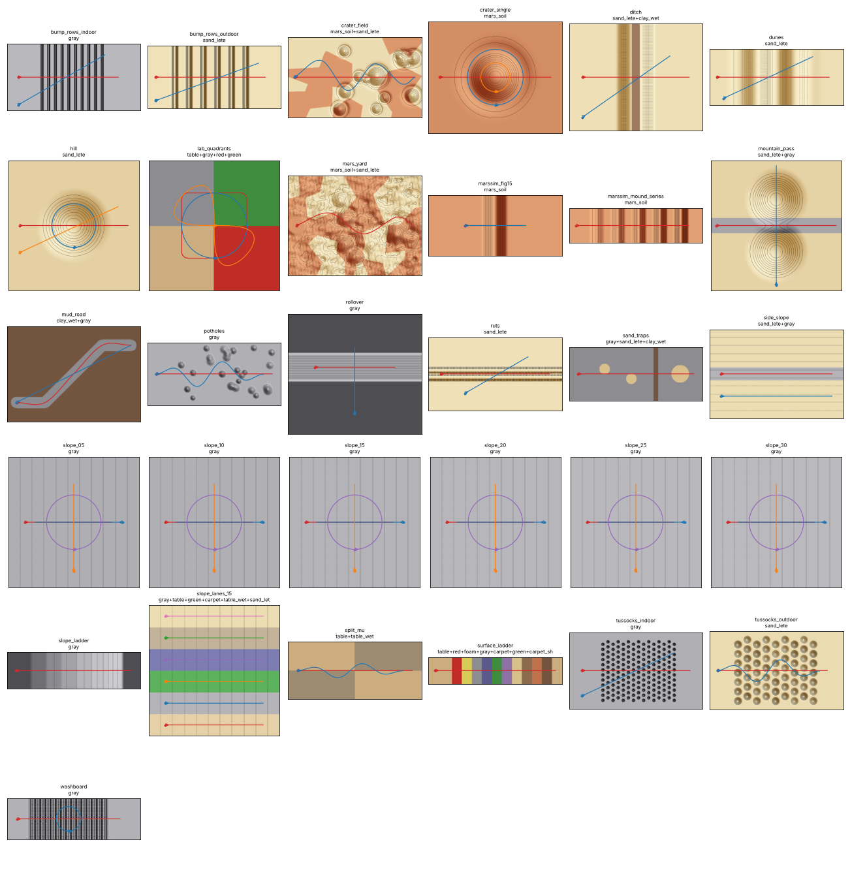

# Maps: terrain, surfaces and ready-made runs

[Русская версия](../ru/MAPS.md)

There are two ways to give a robot a terrain:
* **map files** `configs/maps/*.yaml` — bounds, surface zones, relief and ready-made runs (scenarios). 31 maps and a
  commented template come with the project; you can edit them and add your own;
* **generators on the command line** — `--relief` and `--floor` of `scripts/drive.sh` (§6), for quick experiments.

A map file has bounds, a default surface, surface zones, relief (heights), optional map-local surfaces, the robots to
use and scenarios (start pose and trajectory). The surfaces are the terrasim library ([SURFACES](SURFACES.md)); a map
can declare its own. A commented example to start from: [`examples/maps/my_first_map.yaml`](../../examples/maps/my_first_map.yaml)
(walkthrough: [EXAMPLES §5](EXAMPLES.md#5-your-own-map-step-by-step)).

```bash
python3 tools/maps.py list                                   # all maps: size, surfaces, heights, slope, scenarios
python3 tools/maps.py show slope_15                          # one map, with the contact-model check per robot
python3 tools/maps.py preview slope_ladder --out /tmp        # picture: surfaces, contours, routes, height profile
bash scripts/drive.sh --map slope_15                         # default (first) scenario with the map's robots
bash scripts/drive.sh --map "slope_15@*" --robot husky       # every scenario of the map
bash scripts/drive.sh --map hill@contour --robot jackal --engine harmonic --gui
bash scripts/drive.sh --map slope_15 --map-set relief.0.slope_deg=12 --map-set default_surface=sand_lete
bash scripts/drive.sh --map "slope_10,slope_20,marssim_fig15@fig15" --robot rover    # several maps at once
bash scripts/robotino.sh --engine emulate --map slope_05 --surfaces gray --speeds 0.1  # Robotino star on a map
```

What comes from the map unless given on the command line: the start pose, trajectory and speed (from the scenario)
and the robots (from `robots:`). With `--map`, `--relief` and `--floor` are not used. Surfaces of a ready map:
* `--surface table` — table instead of `default_surface`, the zones stay;
* `--map-set default_surface=table` — the same through the file key; `--map-set zones=[]` removes the zones.

## 1. Catalogue



| map | what it is | size, m | surfaces | scenarios | default robots |
|---|---|---|---|---|---|
| [`bump_rows_indoor`](../maps/bump_rows_indoor.png) | Rows of 2 cm transverse bumps every 60 cm | 12×6 | gray | across, diagonal | robotino, burger, waffle, youbot |
| [`bump_rows_outdoor`](../maps/bump_rows_outdoor.png) | Rows of 10 cm ridges every 1.8 m on sand | 17×8 | sand_lete | across, diagonal | jackal, husky, rover, pioneer |
| [`crater_field`](../maps/crater_field.png) | Crater field on Mars soil | 20×12 | mars_soil, sand_lete | cross, tour | rover, husky, jackal |
| [`crater_single`](../maps/crater_single.png) | Crater R 2.5 m, 0.5 m deep | 12×10 | mars_soil | through, rim, inside | rover, husky, jackal |
| [`ditch`](../maps/ditch.png) | 35 cm ditch with clay at the bottom | 10×8 | sand_lete, clay_wet | straight, oblique | husky, jackal, rover, pioneer |
| [`dunes`](../maps/dunes.png) | Dunes ±35 cm, 6 m wavelength | 19×8 | sand_lete | across, oblique | rover, husky, jackal |
| [`hill`](../maps/hill.png) | 0.9 m hill (up to 22°) on sand | 12×12 | sand_lete | over, contour, diagonal | husky, jackal, rover, pioneer |
| [`lab_quadrants`](../maps/lab_quadrants.png) | Four calibrated floors, one per quadrant | 6×6 | table, gray, red, green | square, circle, figure8 | robotino, burger, waffle, youbot |
| [`mars_yard`](../maps/mars_yard.png) | Mars yard: craters, rocks, roughness | 16×12 | mars_soil, sand_lete | cross | rover, husky, jackal |
| [`marssim_fig15`](../maps/marssim_fig15.png) | MarsSim Fig. 15 mound on MarsSim soil | 11×5 | mars_soil | fig15, fast | rover, husky, jackal |
| [`marssim_mound_series`](../maps/marssim_mound_series.png) | Series of Fig. 15 mounds of growing height (5→24°) | 19×5 | mars_soil | cross | rover, husky, jackal |
| [`mountain_pass`](../maps/mountain_pass.png) | Pass between two hills, road over the saddle | 12×12 | sand_lete, gray | pass, over | husky, jackal, pioneer, rover |
| [`mud_road`](../maps/mud_road.png) | Winding road through a clay field | 14×10 | clay_wet, gray | road, shortcut | jackal, husky, pioneer, robotino |
| [`potholes`](../maps/potholes.png) | Potholes up to 6 cm | 15×7 | gray | straight, slalom | jackal, husky, pioneer |
| [`ruts`](../maps/ruts.png) | 5 cm ruts at the Husky track width | 11×6 | sand_lete | in_ruts, cross_ruts | husky, jackal |
| [`sand_traps`](../maps/sand_traps.png) | Sand traps under one side and a clay strip | 15×6 | gray, sand_lete, clay_wet | straight | robotino, burger, jackal, pioneer |
| [`side_slope`](../maps/side_slope.png) | 15° side slope: sand and a road along the slope | 12×8 | sand_lete, gray | road, sand | jackal, husky, pioneer, robotino |
| [`rollover`](../maps/rollover.png) | 55° slope for rollover tests (use --on-tip continue) | 10×9 | gray | across, up | husky, jackal |
| [`slope_05`](../maps/slope_05.png) | Inclined plane of 5° over the whole map, uphill along +x | 12×12 | gray | up, down, across, circle | burger, waffle, robotino, youbot, pioneer, jackal, husky, rover |
| [`slope_10`](../maps/slope_10.png) | Inclined plane of 10° over the whole map, uphill along +x | 12×12 | gray | up, down, across, circle | burger, waffle, robotino, youbot, pioneer, jackal, husky, rover |
| [`slope_15`](../maps/slope_15.png) | Inclined plane of 15° over the whole map, uphill along +x | 12×12 | gray | up, down, across, circle | burger, waffle, robotino, youbot, pioneer, jackal, husky, rover |
| [`slope_20`](../maps/slope_20.png) | Inclined plane of 20° over the whole map, uphill along +x | 12×12 | gray | up, down, across, circle | burger, waffle, robotino, youbot, pioneer, jackal, husky, rover |
| [`slope_25`](../maps/slope_25.png) | Inclined plane of 25° over the whole map, uphill along +x | 12×12 | gray | up, down, across, circle | burger, waffle, robotino, youbot, pioneer, jackal, husky, rover |
| [`slope_30`](../maps/slope_30.png) | Inclined plane of 30° over the whole map, uphill along +x | 12×12 | gray | up, down, across, circle | burger, waffle, robotino, youbot, pioneer, jackal, husky, rover |
| [`slope_ladder`](../maps/slope_ladder.png) | Slope grows in steps 5→30° every 2.5 m | 22×6 | gray | up | burger, waffle, robotino, youbot, pioneer, jackal, husky, rover |
| [`slope_lanes_15`](../maps/slope_lanes_15.png) | 15° slope, six lanes of different surfaces | 12×12 | gray, table, green, carpet, table_wet, sand_lete | table, gray, green, carpet, table_wet, sand_lete | robotino, burger, jackal, husky |
| [`split_mu`](../maps/split_mu.png) | Different grip under the two sides (dry / wet) | 14×6 | table, table_wet | straight, slalom | jackal, husky, robotino, burger, pioneer |
| [`surface_ladder`](../maps/surface_ladder.png) | Strips of all surfaces from the table to clay | 20×4 | table, red, foam, gray, carpet, green, carpet_shag, sand_lete, sandy_loam, mars_soil, clay_wet | cross | robotino, burger, youbot, pioneer, jackal, husky, rover |
| [`tussocks_indoor`](../maps/tussocks_indoor.png) | Field of 2.5 cm tussocks in staggered rows | 10.5×6 | gray | across, diagonal | robotino, burger, waffle, youbot |
| [`tussocks_outdoor`](../maps/tussocks_outdoor.png) | Field of large tussocks up to 10 cm on sand | 17×10 | sand_lete | across, slalom | jackal, husky, rover, pioneer |
| [`washboard`](../maps/washboard.png) | Washboard: ±1 cm waves every 0.5 m | 13×4 | gray | across, circle | burger, robotino, waffle, jackal |

Groups:
* **Slopes.** `slope_05` … `slope_30` (a plane over the whole map: up, down, across, circle); `slope_ladder` (5→30° in
  steps, one run shows where a robot stops); `slope_lanes_15` (one slope, six surfaces); `side_slope` (across a slope); `rollover` (55°, for falls and rollovers
  with `--on-tip continue`).
* **MarsSim.** `marssim_fig15` (the Fig. 15 mound, MarsSim soil, the experiment speed 0.019 m/s);
  `marssim_mound_series` (five such mounds 7–35 cm high); `crater_single`, `crater_field`, `mars_yard`.
* **Bumps.** `bump_rows_*` (transverse ridges), `tussocks_*` (staggered rows of bumps), `washboard`, `potholes`.
  `_indoor` variants are scaled for TurtleBot and Robotino, `_outdoor` for Jackal, Husky and the rover.
* **Relief.** `hill`, `mountain_pass`, `ditch` (clay at the bottom), `ruts` (at the Husky track width), `dunes`.
* **Surfaces on flat ground.** `lab_quadrants` (the four calibrated Robotino floors), `surface_ladder` (strips of all
  11 surfaces), `sand_traps` (a trap under one side), `split_mu` (different grip under the two sides), `mud_road`.

Run every scenario of every map with its robots in the emulator (a few minutes with `--jobs 4`):
```bash
bash scripts/drive.sh --map "$(python3 -c "import sys; sys.path.insert(0,'tools'); import maps; print(','.join(n+'@*' for n in maps.all_names()))")" --jobs 4 --no-figures
python3 tools/maps.py results runs_drive/<folder>/summary.csv --out /tmp/maps_results.png   # one picture of the outcome
```

## 2. File format

```yaml
world:
  name: my_map
  description: ...
  tags: [slope]                           # for the catalogue
  default_surface: gray                   # wherever no zone applies
  bounds: {xmin: -4, xmax: 4, ymin: -3, ymax: 3}
  resolution: 0.02                        # grid step of heights and surfaces, m
  zones:   [ ... ]                        # surfaces, in order: a later zone overrides an earlier one
  relief:  [ ... ]                        # relief elements, in order
  surfaces: {my_sand: {base: sand_lete, mu: 0.51, _color: "0.9 0.8 0.5 1"}}   # map-local surfaces (optional)
  robots:  [husky, jackal]                # robots used when --robot is not given
  scenarios:
    across: {spawn: [-3, 0, 0], traj: "line:L=6", speed: 0.2, note: ...}
    tour:   {route: [[-3, -2], [0, 0], [3, 2]]}
```
JSON with the same structure works too; the `world:` key is optional. The commented template with every zone and
relief type is [`configs/maps/_template.yaml`](../../configs/maps/_template.yaml).

### 2.1 Zones
`surface:` (or `name:`) is the surface name; `area: [xmin, xmax, ymin, ymax]` limits any zone to a rectangle.

| type | parameters |
|---|---|
| `rect` | `xmin, xmax, ymin, ymax` |
| `polygon` | `points: [[x, y], ...]` |
| `circle` | `center, radius` |
| `ring` | `center, r_in, r_out` |
| `band` | a strip along a polyline: `points, width` (full width) |
| `halfplane` | `dir_deg, offset, origin`: everything beyond `offset` in the direction `dir_deg` |
| `stripes` | `surfaces: [a, b, ...], width, dir_deg` |
| `checkerboard` | `surfaces, cell, origin` |
| `voronoi` | `surfaces, cell, seed` |
| `grid` | `file` (.npz with L = classes, x0, y0, res), `surfaces: {class: surface}` — a raster of classes |

### 2.2 Relief
Directed elements have `dir_deg` (direction of the u axis) and `origin` (where u = 0). Bumps are cosine domes:
smooth, with zero slope at the edge.

| type | parameters | what it is |
|---|---|---|
| `plane` | `slope_deg, dir_deg, origin` | inclined plane over the whole map (height 0 at `origin`) |
| `ramp` | `slope_deg, from, to, blend, dir_deg` | ramp from `from` to `to`, then a plateau; breaks rounded over `blend` |
| `slopes` | `start, segments: [{slope_deg, length}, ...], blend, then: flat\|continue` | sections of different steepness in a row |
| `mound` | `x_start, L_up, L_top, L_down, height, smooth, dir_deg` | MarsSim Fig. 15 mound (smoothed trapezoid across the map) |
| `ridges` | `height, width, pitch, from, to` or `count`, `dir_deg` | rows of transverse ridges |
| `bump`, `hill` | `center, height, radius` | one bump or hill (`height < 0`: a hole) |
| `bump_rows` | `height, radius, pitch` or `[pitch_u, pitch_v]`, `area: [u0, u1, v0, v1]`, `stagger, jitter, sign: up\|down\|mixed, seed, dir_deg` | bumps on a lattice |
| `bumps` | `n, height, radius` or `[rmin, rmax]`, `area, seed, signed, avoid: [[x, y, r], ...]` | random bumps |
| `crater` | `center, radius, depth, rim, rim_width` | crater with a rim (rim height as a share of the depth, width as a share of the radius) |
| `craters` | `n, radius: [rmin, rmax], depth_ratio, rim, area, seed, avoid` | crater field |
| `waves` | `amplitude, wavelength, dir_deg, from, to` | sine waves (smoothly switched on at `from` and off at `to`) |
| `rough` | `amplitude` (RMS), `wavelength, beta, octaves, seed, area` | fractal roughness |
| `trench`, `berm` | `points, width, flat, height` | ditch or bank along a polyline: slope of half-width `width`, flat bottom / top of half-width `flat` |
| `image` | `file, height, area, blur, invert` | height map from a picture: black = 0, white = `height`; path relative to the map file |
| `flatten` | `center, radius, blend, level` | flat pad (start) |
| `grid` | `file` (.npz with H, x0, y0, res), `scale` | height field from a file (e.g. a terrain reconstructed from a recording) |

### 2.3 Scenarios
* `spawn: [x, y, heading°]` and `traj` — as `--traj` ([RUNNING](RUNNING.md#3-trajectories)); the trajectory starts at the spawn.
* `route: [[x, y], ...]` — a path through map points: a spline from the first point, heading to the second.
* `speed` — cruise speed, m/s (otherwise the robot's default).
* `robots` — robots of this scenario (otherwise the map's list).
* The first scenario is the default; `NAME@*` runs all of them.

### 2.4 Changing values without editing: `--map-set`
`--map-set key=value` changes any value by its path inside `world`: `relief.0.slope_deg=12`, `zones.2.radius=0.8`,
`scenarios.up.traj=line:L=3`, `bounds.xmax=10`, `default_surface=sand_lete`.

## 3. Your own map

```bash
python3 tools/maps.py new my_map                       # configs/maps/my_map.yaml from the template
python3 tools/maps.py preview my_map --out /tmp        # look at it
python3 tools/maps.py check my_map --robot burger,husky   # is the relief valid for these wheels, are the routes inside the map
bash scripts/drive.sh --map my_map --engine emulate    # quick check
bash scripts/drive.sh --map my_map --engine harmonic --gui
python3 tools/maps.py catalog                          # refresh configs/maps/catalog.yaml (index only)
python3 tools/maps.py preview all                      # refresh docs/maps/*.png
```
A map can also live anywhere: `--map /path/to/map.yaml`. `python3 tools/maps.py build my_map --out /tmp/m` writes the
`map.dtm` and the Gazebo meshes without running anything.

## 4. Is the relief valid for the contact model?

The wheel touches the ground **at one point below its centre**, on the tangent plane of the relief. That is exact for
slopes and smooth hills. For a bump narrower than the wheel it is not: a real wheel bridges a narrow hole and hits the
edge of a step with its rim.

`maps.py check` and `drive.sh --map` estimate the error of this approximation as 0.5·κ·r² (κ the largest curvature of
the relief, r the radius of the driven wheel):
* **ok** — error ≤ 5 % of r;
* **approx** — ≤ 25 % of r: the relief is not more curved than a circle of the wheel's diameter; results are approximate;
* **invalid** — larger: the wheel is bigger than the feature; make the feature wider or use a robot with smaller wheels.

In the shipped set one pair is marked: the narrow `ruts` for Husky (the lateral curvature of a rut is compared with the
wheel radius, which is stricter than needed).

## 5. Limitations
* **No rigid obstacles or steps** (single-point wheel contact). An `obstacles` key is rejected with an explanation.
  Use `berm` instead of a wall and `ramp` with a small `blend` instead of a step.
* **The body touches the ground** (`--body-contact on`): robots scrape their bellies on bumps and roll over on steep
  slopes. A run stops 0.2 s after the chassis tilts more than 50° to the ground; `--on-tip continue` lets it go on
  (map `rollover`).
* **Beyond the map edge** the relief continues with the edge value; leaving the map cuts the run (`left_map`).
* **The rover in the emulator has a rigid chassis.** Look at it on bumps and in craters in Gazebo.
* **Robotino star on a map** starts at (0, 0) and uses the base library; map-local `surfaces:` are not used there.

## 6. Generators on the command line (`--relief`, `--floor`)

The map is a square of ±`--map-size` around (0, 0) with the grid step `--res`. Several reliefs add up with `;`; quote
specs that contain `;` or `|` in the shell.

| `--relief` | parameters (defaults) | what it is |
|---|---|---|
| `flat` | – | flat floor |
| `hills` | `A`=0.01, `L`=0.4, `r0`=0.3, `r1` | concentric smooth rings of height A |
| `bumps` | `n`=30, `h`=0.03, `w`=0.2, `signed`=0 | random Gaussian bumps (`signed=1`: holes too) |
| `craters` | `n`=6, `R`=0.8, `depth`=0.12, `rim`=0.3 | craters: bowl and rim |
| `waves` | `A`=0.03, `L`=1, `angle`=0 | parallel waves |
| `ramp` | `angle`=10, `x0`=0.5, `x1` | slope along +x, then a plateau |
| `rough` | `A`=0.03, `L`=2, `beta`=2, `octaves`=6 | fractal roughness (spectrum ~1/k^β), A = RMS height |

Common: `seed`, `flat0=R` (a flat disc of radius R around the centre, the start area).

| `--floor` | parameters | what it is |
|---|---|---|
| `uniform` | `surface` | one surface |
| `checkerboard` | `surfaces=A+B[+C...]`, `cell`=1 | checkerboard |
| `voronoi` (`voronoi_mosaic`, `patches`) | `surfaces`, `cell`=1, `seed` | random polygonal patches |
| `stripes` | `surfaces`, `w`=1, `angle`=90 | stripes |
| `rings` | `surfaces`, `w`=0.5, `r0`=0.3 | concentric rings |
| `sectors` | `surfaces` | angular sectors |
| `half` | `surfaces=A+B`, `angle`=0, `offset`=0 | two halves with a straight border |

`r0start=R`: surface number 0 within R of the centre.

```bash
bash scripts/drive.sh --robot husky --relief "craters:n=5,R=1.5,depth=0.15,flat0=1.5" --floor "voronoi:surfaces=gray+sand_lete,cell=2" --traj square:L=4,rc=0.6
bash scripts/drive.sh --robot robotino --floor "checkerboard:surfaces=gray+carpet,cell=0.5|stripes:surfaces=gray+table_wet,w=0.7" --traj circle:R=1
```
The Robotino star (`robotino.sh --map`) has its own small set: `hills:A,L`, `rings:surfaces,w`, `sectors:surfaces`,
`patches:surfaces,cell`, `file:/path/map.dtm` or a map file name (`tools/gen_maps.py`).
