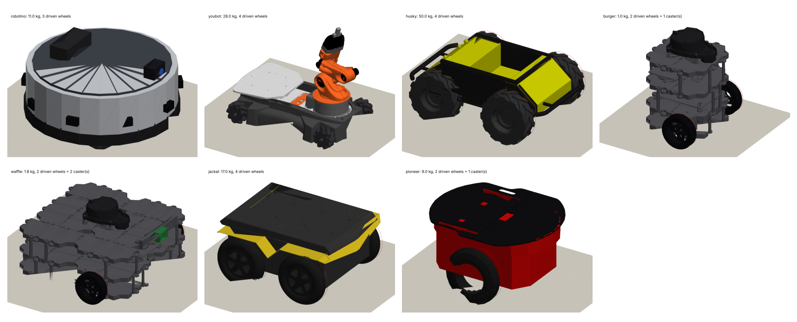

# Robots: built-in models, changing parameters, your own robot

[Русская версия](../ru/ROBOTS.md)

All robots go through the same vehicle mode of the core (`vehicle_logic.hpp`): wheels of any type, motor groups,
trajectory, controller, odometry, IMU. A robot is a Python dictionary in [`tools/robots.py`](../../tools/robots.py) or a
JSON file in `configs/robots/`. From it the tools write the plugin INI (`[robot]`, `[wheel k]`, `[motor]`) and the
Gazebo SDF model.



Red circles in the previews (`python3 tools/robot_preview.py`) are the wheel radii used by the contact model; the meshes
are only visuals.

## 1. Built-in robots

Legend: **D** — datasheet / manufacturer description (URDF, manual, driver config); **C** — calibrated on recorded
runs of the real robot; **E** — physically based estimate.

| robot | mass | wheels | drive | motors | where the numbers come from |
|---|---|---|---|---|---|
| `robotino` (Festo Robotino 1.6) | 11 kg | 3 omni, r = 0.04 m, at 0.125 m, 60°/180°/300° | holonomic, diff | 3 × DC, R 5.34 Ω, Ce = kt 0.0501, gear 16, η 0.8, I0 0.17 A | geometry D; centre of mass, motor, controller, encoder (1970 counts/rev) and the four calibrated floors C |
| `youbot` (KUKA youBot base + folded arm) | 28 kg | 4 mecanum, r = 0.0475 m, x ±0.228, y ±0.158 | holonomic, diff | 4 × maxon EC 45 flat class, kt 0.0335, gear 25.84, I0 0.20 A | geometry, gear, encoders D (`youbot_description`, `youbot-base.cfg`); I0 and roller friction `mu_rb` = 0.104 C; R, η E |
| `husky` (Clearpath Husky A200) | 50 kg | 4 standard, r = 0.1651 m, wheelbase 0.512, track 0.571 | diff (skid steer) | 2 (one per side, chain to both wheels), gear 79 | geometry D (`husky_description`); I0 1.77 A, η 0.713, tyre lateral grip 0.981 C; R, kt E |
| `rover` (MarsSim rocker-bogie) | 190 kg | 6 standard, r = 0.14 m, b = 0.2 m | diff | 6 × independent, gear 160 | geometry from the MarsSim paper; motors E (the paper gives none) |
| `burger` (TurtleBot3 Burger) | 1.0 kg | 2 standard r = 0.033 m + ball caster | diff | 2 × DYNAMIXEL XL430, gear 258.5 | D (ROBOTIS e-Manual); R, Ce, η derived from stall / no-load data; centre of mass E |
| `waffle` (TurtleBot3 Waffle Pi) | 1.8 kg | 2 standard r = 0.033 m + 2 ball casters | diff | 2 × DYNAMIXEL XM430, gear 212.6 | as Burger |
| `jackal` (Clearpath Jackal) | 17 kg | 4 standard, r = 0.098 m | diff (skid steer) | 2 (one channel per side) | geometry, inertia D (`jackal_description`); motors E |
| `pioneer` (Pioneer 3-DX) | 9 kg | 2 standard r = 0.0975 m + swivel caster | diff | 2 × 12 V, gear 38.3 | D (datasheet, ARIA); motor R, Ce E; centre of mass E |

The full set of numbers with a comment on every source is in `tools/robots.py` (one function branch per robot). The
Robotino and rover numbers live in `configs/calibrated_params.json` (`robotino.robot`, `robotino.motor`, `rover`).

Husky: the defaults include the values identified on recorded runs of a real Husky (I0 = 1.77 A, η = 0.713,
lat_grip = 0.981). Before the identification they were catalogue estimates (I0 = 0.8 A, η = 0.73, lat_grip = 1.0); to
go back: `--set motor.I0=0.8 --set motor.eta=0.73 --set wheel.lat_grip=1.0`.

## 2. Changing parameters of a robot

### 2.1 For one run: `--set`
```bash
bash scripts/drive.sh --robot husky --set robot.mass=70 --set robot.com_h=0.3     # payload
bash scripts/drive.sh --robot jackal --set motor.gear=30 --set motor.I0=0.4          # another gearbox
bash scripts/drive.sh --robot burger --set wheel.patch=0.02 --set caster.r=0.008     # every wheel / every caster
bash scripts/drive.sh --robot youbot --set controller.ky=6 --set imu.gyro_bias=0.01  # controller, IMU
```

| target | what it changes |
|---|---|
| `robot.<key>` | a robot key: `mass`, `com_x`, `com_y`, `com_h`, `Jw`, `encoder_ticks`, `odom_yaw_scale`, `speed`, `accel`, `v_max`, `w_max`, ... |
| `motor.<key>` | `R`, `Ce`, `kt`, `gear`, `eta`, `I0`, `w_eps`, `Vmax`, `Vd`, `kp`, `ki`, `ff` |
| `wheel.<key>` | the same key on every wheel: `r`, `b`, `patch`, `mu_rb`, `lat_grip`, `zmax_r`, `gamma_deg`, ... |
| `caster.<key>` | the same key on every caster |
| `controller.<key>` | `kp_xy`, `k_yaw`, `kx`, `ky`, `kth`, `v_max`, `w_max`, `rate` |
| `imu.<key>` | `rate`, `gyro_sigma`, `gyro_bias`, `gyro_rw`, `acc_sigma`, `acc_bias`, `acc_rw`, `seed` |
| `contact.<key>` | contact options: `slip_v_eps`, `slip_relax_len`, `slip_max`, ... |
| `body.<key>` | body-ground contact: `k`, `c` (per point), `mu` ([PHYSICS §2.7](PHYSICS.md#27-body-ground-contact-falls-and-rollovers)) |
| `<surface>.<key>` | a surface parameter ([SURFACES](SURFACES.md)) |

In `robotino.sh` the targets are `robot.<key>` and `motor.<key>` of `configs/calibrated_params.json`, plus surfaces.

### 2.2 Permanently: a robot file derived from a built-in robot
Create `configs/robots/<name>.json` with `"base"` and the keys to change (example:
[`examples/robots/husky_payload.json`](../../examples/robots/husky_payload.json)):

```json
{
 "base": "husky",
 "mass": 70.0,
 "com": [0.0, 0.0, 0.30],
 "motor": {"gear": 50.0},
 "wheel": {"patch": 0.10},
 "speed": 0.8
}
```

Dictionaries (`motor`, `ctrl`) are merged key by key, `wheel` changes every wheel, any other key replaces the base
value. The derived robot keeps the meshes of its base. Run it by name: `bash scripts/drive.sh --robot husky_heavy`
(file `configs/robots/husky_heavy.json`) or by path: `--robot path/to/robot.json`. `robotino` and `rover` cannot be
used as a base (their Gazebo models are special); change them with `--set` or in `configs/calibrated_params.json`.

## 3. Your own robot: a full robot file

Copy one of the examples to `configs/robots/<name>.json` and edit it (step-by-step walkthrough:
[EXAMPLES §3](EXAMPLES.md#3-your-own-robot-step-by-step)):

| example | layout |
|---|---|
| [`examples/robots/my_diffbot.json`](../../examples/robots/my_diffbot.json) | two driven wheels + a ball caster |
| [`examples/robots/my_skidsteer.json`](../../examples/robots/my_skidsteer.json) | four wheels, skid steering |

```bash
cp examples/robots/my_skidsteer.json configs/robots/my_rover.json
python3 tools/robot_preview.py --robots my_rover --body --out /tmp/prev   # wheel circles in red, body contact points in blue
bash scripts/drive.sh --list                                         # it is listed with the built-in robots
bash scripts/drive.sh --robot my_rover --engine emulate --traj square:L=3,rc=0.5
bash scripts/drive.sh --robot my_rover --engine harmonic --gui --map slope_10@up
```
A robot file also works by its path without copying: `--robot examples/robots/my_skidsteer.json`.

### 3.1 Robot keys
| key | required | meaning |
|---|---|---|
| `mass` | yes | total mass, kg |
| `com` | yes | centre of mass [x, y, h] in the body frame, m (h = height above the ground) |
| `I` | yes | body inertia [Ixx, Iyy, Izz] about the centre of mass, kg·m² |
| `Jw` | yes | spin inertia of one driven wheel with the motor rotor reflected through the gear (J_rotor·gear² + J_wheel), kg·m² |
| `size` | yes | body box [length, width, height], m: collision box in Gazebo and the body drawn when there are no meshes |
| `wheels` | yes | list of wheels (§3.2) |
| `motor` | yes | `R` (Ω), `Ce` (V·s/rad), `kt` (N·m/A), `gear`, `eta`, `I0` (A), `Vmax` (V), `kp`, `ki` (speed loop), optional `Vd`, `ff`, `w_eps` |
| `drive` | yes | `["diff"]` (skid steer / differential) and/or `"holonomic"` (omni / mecanum); the first is the default |
| `body_off` | no | centre of the body box [x, y, z] (default [0, 0, com h]) |
| `wheel_mass` | no | mass of one driven wheel link in Gazebo (default 0.5 kg) |
| `encoder_ticks` | no | encoder counts per motor revolution (default 1024) |
| `odom_yaw_scale` | no | skid steer: 1 / `wheel_separation_multiplier` of the ROS diff-drive controller (default 1) |
| `speed`, `accel`, `v_max`, `w_max` | no | default cruise speed, acceleration and the limits of the controller |
| `map_size`, `map_res` | no | default half-size and grid step of generated maps, m |
| `ctrl` | no | path controller gains: `kp_xy`, `k_yaw` (holonomic), `kx`, `ky`, `kth` (diff, Kanayama) |
| `chassis` | no | name of the body link (default `base_link`) |

### 3.2 Wheel keys
| key | required | meaning |
|---|---|---|
| `label` | yes | short name used in the logs (`w<label>_...`) |
| `x`, `y` | yes | wheel centre in the body frame, m |
| `r` | yes | radius, m |
| `type` | yes | `standard` (tyre), `omni`, `mecanum`, `caster` (passive) |
| `group` | yes | motor number (wheels with the same number share one motor; casters get −1) |
| `b`, `patch` | no | tread width and contact length on firm ground, m (default: the surface's `b_contact`, `patch_len`) |
| `heading_deg` | no | rolling direction for positive spin (default 0 = forward) |
| `gamma_deg` | no | roller angle: 90 omni, ±45 mecanum (sign = X-configuration side) |
| `mu_rb` | no | roller bearing friction of this wheel (overrides the surface) |
| `lat_grip` | no | tyres: lateral / longitudinal grip ratio (default 1) |
| `zmax_r` | no | sinkage limit / r (default 0.6) |
| `z` | no | wheel centre height (emulator), default r |
| `link`, `joint` | no | SDF names (default `wheel_<label>`, `wheel_<label>_joint`) |
| casters: `J`, `swivel`, `trail`, `swivel_h`, `mass` | no | spin inertia, free swivel (1/0), trail and height of the swivel axis, caster mass |

### 3.3 Things to know
* **Gazebo model.** For robots without meshes the body is drawn as its collision box and the wheels as cylinders.
  The generic Gazebo model puts every wheel axle along the body y axis, so in Gazebo every wheel must roll forward
  (`heading_deg` = 0): differential, skid-steer and mecanum layouts work. Layouts with rotated wheels (a three-wheel
  omni base like Robotino) run in the emulator; for Gazebo they need their own model branch in `tools/robots.py`
  (see `sdf_model` and the Robotino model in `tools/gz_sdf.py`).
* **Meshes.** To give your robot a CAD look, add a branch to `visuals()` in `tools/robots.py` with your meshes in
  `models/meshes/<robot>/` and set `"look": "<that branch name>"` in the robot file.
* **Motors from a datasheet.** With supply U, no-load speed ω₀ (at the output), stall current I_s and stall torque M_s
  at the output: Ce = kt = U / (ω₀·gear), R = U / I_s, η = M_s / (Ce·gear·I_s).
* **Surfaces** are the same for every robot. They were calibrated on Robotino; check the surfaces you rely on against
  data of your robot if you have them (the `_fit` surfaces of the tyre library are an example).
* **Contact stiffness** is scaled with the static wheel load automatically; `--kn-scale` < 1 softens all wheels (tyres).

### 3.4 Optional keys of a robot file
| key | meaning |
|---|---|
| `body` | shapes of the body for the ground contact (§3.5); default: the `size` box at `body_off` |
| `look` | name of a branch of `visuals()` in `tools/robots.py` whose meshes the robot uses |
| `base` | a built-in robot to start from (§2.2) |
| `wheel` | with `base`: keys set on every wheel |

### 3.5 Body shape for the ground contact
The body touches the ground at points of a few simple shapes ([PHYSICS §2.7](PHYSICS.md#27-body-ground-contact-falls-and-rollovers)).
Give them in the robot file as a list; boxes give 26 points, cylinders 26, and every non-caster wheel adds 4 points on
its outer face:
```json
"body": [
  {"box": [0.57, 0.36, 0.10], "at": [0.0, 0.0, 0.08]},
  {"box": [0.16, 0.16, 0.40], "at": [0.175, 0.0, 0.33]},
  {"cyl": [0.05, 0.30], "at": [-0.1, 0.0, 0.45]}
]
```
`box`: [length, width, height], `cyl`: [radius, height] (vertical axis), `at`: centre in the robot frame. Keep the
bottom of the lowest shape at the real ground clearance: lower, and the body scrapes the ground on bumps it would clear.

Built-in robots:

| robot | shapes | ground clearance |
|---|---|---|
| robotino | cylinder r 0.18 m, 0.05–0.17 m | 5 cm |
| youbot | base box 0.57 × 0.36 × 0.10 m + box of the folded arm up to 0.53 m | 3 cm |
| husky | box 0.99 × 0.57 × 0.25 m (with bumpers) | 13 cm |
| rover | box 1.15 × 0.85 × 0.45 m on the chassis | 47 cm |
| burger, waffle | the collision box of the ROBOTIS description | 1 cm |
| jackal | box 0.42 × 0.31 × 0.18 m | 6 cm |
| pioneer | box 0.42 × 0.34 × 0.22 m | 5.5 cm |

## 4. Gazebo models of the built-in robots

| robot | links | look |
|---|---|---|
| Robotino | `base_link` + 3 wheels | procedural: body, bumper, deck, control unit, camera, 9 IR sensors, omni wheels with 2 × 12 rollers |
| youBot | `base_link` + 4 wheels | CAD: base, plate, mecanum wheels, arm in folded pose |
| Husky | `base_link` + 4 wheels | CAD: body, top, rail, bumpers, wheels |
| rover | `chassis` + rockers + bogies + 6 wheels | procedural; the rocker differential is part of the plugin |
| Burger, Waffle Pi | `base_link` + 2 wheels + ball casters | CAD (ROBOTIS, decimated), lidar |
| Jackal | `base_link` + 4 wheels | CAD: body, fenders, wheels |
| Pioneer 3-DX | `base_link` + 2 wheels + swivel caster | CAD: body, deck, swivel fork, wheels |

Meshes are in `models/meshes/` (sources and licences: [`models/meshes/SOURCES.md`](../../models/meshes/SOURCES.md)).
The SDF refers to them with absolute paths and the world is written anew for every run, so the project folder can be
anywhere. `--gz-sensors` adds the native Gazebo IMU sensor, OdometryPublisher and JointStatePublisher to the model.

In the emulator the rover has a rigid chassis; its rocker-bogie works only in Gazebo.
