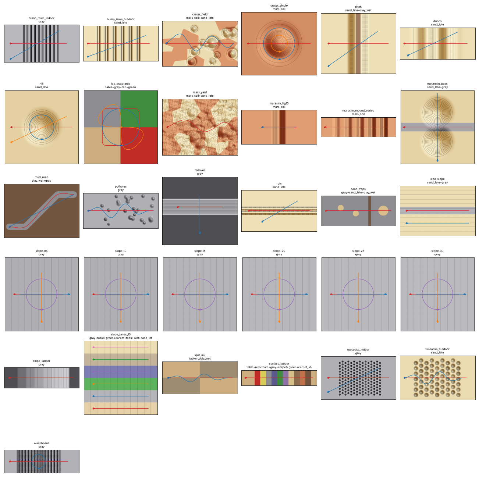

# Карты: рельеф, покрытия и готовые заезды

[English version](../en/MAPS.md)

Задать роботу рельеф можно двумя способами:
* **файлы карт** `configs/maps/*.yaml` — границы, зоны покрытий, рельеф и готовые заезды (сценарии). В проекте 31 карта и
  шаблон с комментариями; их можно править и добавлять свои;
* **генераторы в командной строке** — `--relief` и `--floor` у `scripts/drive.sh` (§6), для быстрых опытов.

В файле карты — границы, покрытие по умолчанию, зоны покрытий, рельеф (высоты), по желанию свои поверхности карты,
роботы и сценарии (точка старта и траектория). Поверхности — из библиотеки terrasim ([SURFACES](SURFACES.md)); карта
может объявить и свои. Пример с комментариями, с которого удобно начать:
[`examples/maps/my_first_map.yaml`](../../examples/maps/my_first_map.yaml) (разбор: [EXAMPLES §5](EXAMPLES.md#5-своя-карта-по-шагам)).

```bash
python3 tools/maps.py list                                   # все карты: размер, покрытия, высоты, уклон, сценарии
python3 tools/maps.py show slope_15                          # одна карта и проверка модели контакта по роботам
python3 tools/maps.py preview slope_ladder --out /tmp        # картинка: покрытия, изолинии, маршруты, профиль высоты
bash scripts/drive.sh --map slope_15                         # сценарий по умолчанию (первый) и роботы карты
bash scripts/drive.sh --map "slope_15@*" --robot husky       # все сценарии карты
bash scripts/drive.sh --map hill@contour --robot jackal --engine harmonic --gui
bash scripts/drive.sh --map slope_15 --map-set relief.0.slope_deg=12 --map-set default_surface=sand_lete
bash scripts/drive.sh --map "slope_10,slope_20,marssim_fig15@fig15" --robot rover    # несколько карт за раз
bash scripts/robotino.sh --engine emulate --map slope_05 --surfaces gray --speeds 0.1  # «звезда» Robotino на карте
```

Что берётся из карты, если не задано в командной строке: точка старта, траектория и скорость (из сценария) и роботы
(из `robots:`). С `--map` ключи `--relief` и `--floor` не используются. Покрытие готовой карты:
* `--surface table` — стол вместо `default_surface`, зоны остаются;
* `--map-set default_surface=table` — то же через ключ файла; `--map-set zones=[]` убирает зоны.

## 1. Каталог



| карта | что это | размер, м | покрытия | сценарии | роботы по умолчанию |
|---|---|---|---|---|---|
| [`slope_05`](../maps/slope_05.png) | Наклонная плоскость 5° на всю карту, подъём вдоль +x | 12×12 | gray | up, down, across, circle | burger, waffle, robotino, youbot, pioneer, jackal, husky, rover |
| [`slope_10`](../maps/slope_10.png) | Наклонная плоскость 10° на всю карту, подъём вдоль +x | 12×12 | gray | up, down, across, circle | burger, waffle, robotino, youbot, pioneer, jackal, husky, rover |
| [`slope_15`](../maps/slope_15.png) | Наклонная плоскость 15° на всю карту, подъём вдоль +x | 12×12 | gray | up, down, across, circle | burger, waffle, robotino, youbot, pioneer, jackal, husky, rover |
| [`slope_20`](../maps/slope_20.png) | Наклонная плоскость 20° на всю карту, подъём вдоль +x | 12×12 | gray | up, down, across, circle | burger, waffle, robotino, youbot, pioneer, jackal, husky, rover |
| [`slope_25`](../maps/slope_25.png) | Наклонная плоскость 25° на всю карту, подъём вдоль +x | 12×12 | gray | up, down, across, circle | burger, waffle, robotino, youbot, pioneer, jackal, husky, rover |
| [`slope_30`](../maps/slope_30.png) | Наклонная плоскость 30° на всю карту, подъём вдоль +x | 12×12 | gray | up, down, across, circle | burger, waffle, robotino, youbot, pioneer, jackal, husky, rover |
| [`slope_ladder`](../maps/slope_ladder.png) | Уклон растёт ступенями 5→30° через каждые 2.5 м | 22×6 | gray | up | burger, waffle, robotino, youbot, pioneer, jackal, husky, rover |
| [`slope_lanes_15`](../maps/slope_lanes_15.png) | Склон 15°, шесть дорожек разных покрытий | 12×12 | gray, table, green, carpet, table_wet, sand_lete | table, gray, green, carpet, table_wet, sand_lete | robotino, burger, jackal, husky |
| [`side_slope`](../maps/side_slope.png) | Косогор 15°: песок и дорога вдоль склона | 12×8 | sand_lete, gray | road, sand | jackal, husky, pioneer, robotino |
| [`rollover`](../maps/rollover.png) | Склон 55° для опытов с опрокидыванием (с --on-tip continue) | 10×9 | gray | across, up | husky, jackal |
| [`marssim_fig15`](../maps/marssim_fig15.png) | Холм из Fig.15 MarsSim на грунте Табл. II | 11×5 | mars_soil | fig15, fast | rover, husky, jackal |
| [`marssim_mound_series`](../maps/marssim_mound_series.png) | Серия холмов Fig.15 растущей высоты (5→24°) | 19×5 | mars_soil | cross | rover, husky, jackal |
| [`bump_rows_indoor`](../maps/bump_rows_indoor.png) | Ряды поперечных валиков 2 см через 60 см | 12×6 | gray | across, diagonal | robotino, burger, waffle, youbot |
| [`bump_rows_outdoor`](../maps/bump_rows_outdoor.png) | Ряды поперечных валов 10 см через 1.8 м на песке | 17×8 | sand_lete | across, diagonal | jackal, husky, rover, pioneer |
| [`tussocks_indoor`](../maps/tussocks_indoor.png) | Поле кочек 2.5 см рядами со сдвигом | 10.5×6 | gray | across, diagonal | robotino, burger, waffle, youbot |
| [`tussocks_outdoor`](../maps/tussocks_outdoor.png) | Поле крупных кочек до 10 см на песке | 17×10 | sand_lete | across, slalom | jackal, husky, rover, pioneer |
| [`washboard`](../maps/washboard.png) | Гребёнка: волны ±1 см с шагом 0.5 м | 13×4 | gray | across, circle | burger, robotino, waffle, jackal |
| [`potholes`](../maps/potholes.png) | Выбоины до 6 см | 15×7 | gray | straight, slalom | jackal, husky, pioneer |
| [`crater_single`](../maps/crater_single.png) | Кратер R 2.5 м, глубина 0.5 м | 12×10 | mars_soil | through, rim, inside | rover, husky, jackal |
| [`crater_field`](../maps/crater_field.png) | Поле кратеров на марсианском грунте | 20×12 | mars_soil, sand_lete | cross, tour | rover, husky, jackal |
| [`hill`](../maps/hill.png) | Холм 0.9 м (до 22°) на песке | 12×12 | sand_lete | over, contour, diagonal | husky, jackal, rover, pioneer |
| [`mountain_pass`](../maps/mountain_pass.png) | Перевал между двумя холмами, дорога через седловину | 12×12 | sand_lete, gray | pass, over | husky, jackal, pioneer, rover |
| [`ditch`](../maps/ditch.png) | Канава 35 см с глиной на дне | 10×8 | sand_lete, clay_wet | straight, oblique | husky, jackal, rover, pioneer |
| [`ruts`](../maps/ruts.png) | Колея 5 см под Husky | 11×6 | sand_lete | in_ruts, cross_ruts | husky, jackal |
| [`dunes`](../maps/dunes.png) | Дюны ±35 см, волна 6 м | 19×8 | sand_lete | across, oblique | rover, husky, jackal |
| [`lab_quadrants`](../maps/lab_quadrants.png) | Четыре покрытия датасета по квадрантам | 6×6 | table, gray, red, green | square, circle, figure8 | robotino, burger, waffle, youbot |
| [`surface_ladder`](../maps/surface_ladder.png) | Полосы всех поверхностей от стола до глины | 20×4 | table, red, foam, gray, carpet, green, carpet_shag, sand_lete, sandy_loam, mars_soil, clay_wet | cross | robotino, burger, youbot, pioneer, jackal, husky, rover |
| [`sand_traps`](../maps/sand_traps.png) | Песчаные ловушки под одним бортом и полоса глины | 15×6 | gray, sand_lete, clay_wet | straight | robotino, burger, jackal, pioneer |
| [`split_mu`](../maps/split_mu.png) | Разное сцепление под бортами (сухо / мокро) | 14×6 | table, table_wet | straight, slalom | jackal, husky, robotino, burger, pioneer |
| [`mud_road`](../maps/mud_road.png) | Дорога змейкой через поле глины | 14×10 | clay_wet, gray | road, shortcut | jackal, husky, pioneer, robotino |
| [`mars_yard`](../maps/mars_yard.png) | Марсианский полигон: кратеры, камни, шероховатость | 16×12 | mars_soil, sand_lete | cross | rover, husky, jackal |

Группы:
* **Склоны.** `slope_05` … `slope_30` (плоскость на всю карту: вверх, вниз, поперёк, круг); `slope_ladder` (5→30°
  ступенями, за один заезд видно, где робот встаёт); `slope_lanes_15` (один уклон, шесть покрытий); `side_slope`
  (поперёк склона); `rollover` (55°, для падений и опрокидываний с `--on-tip continue`).
* **MarsSim.** `marssim_fig15` (холм Fig. 15, грунт MarsSim, скорость эксперимента 0.019 м/с); `marssim_mound_series`
  (пять таких холмов высотой 7–35 см); `crater_single`, `crater_field`, `mars_yard`.
* **Кочки.** `bump_rows_*` (поперечные валики), `tussocks_*` (кочки рядами со сдвигом), `washboard`, `potholes`.
  Варианты `_indoor` — в масштабе TurtleBot и Robotino, `_outdoor` — Jackal, Husky и ровера.
* **Рельеф.** `hill`, `mountain_pass`, `ditch` (глина на дне), `ruts` (колея под Husky), `dunes`.
* **Покрытия на ровном полу.** `lab_quadrants` (четыре откалиброванных покрытия Robotino), `surface_ladder` (полосы всех
  11 покрытий), `sand_traps` (ловушка под одним бортом), `split_mu` (разное сцепление под бортами), `mud_road`.

Все сценарии всех карт с их роботами в эмуляторе (несколько минут с `--jobs 4`):
```bash
bash scripts/drive.sh --map "$(python3 -c "import sys; sys.path.insert(0,'tools'); import maps; print(','.join(n+'@*' for n in maps.all_names()))")" --jobs 4 --no-figures
python3 tools/maps.py results runs_drive/<папка>/summary.csv --out /tmp/maps_results.png   # итог одной картинкой
```

## 2. Формат файла

```yaml
world:
  name: my_map
  description: ...
  tags: [slope]                           # для каталога
  default_surface: gray                   # там, где нет зон
  bounds: {xmin: -4, xmax: 4, ymin: -3, ymax: 3}
  resolution: 0.02                        # шаг сетки высот и покрытий, м
  zones:   [ ... ]                        # покрытия по порядку: следующая зона перекрывает предыдущую
  relief:  [ ... ]                        # элементы рельефа по порядку
  surfaces: {my_sand: {base: sand_lete, mu: 0.51, _color: "0.9 0.8 0.5 1"}}   # свои поверхности карты (необязательно)
  robots:  [husky, jackal]                # кого запускать, если --robot не задан
  scenarios:
    across: {spawn: [-3, 0, 0], traj: "line:L=6", speed: 0.2, note: ...}
    tour:   {route: [[-3, -2], [0, 0], [3, 2]]}
```
Можно писать и JSON той же структуры; ключ `world:` необязателен. Шаблон с комментариями и всеми видами зон и рельефа —
[`configs/maps/_template.yaml`](../../configs/maps/_template.yaml).

### 2.1 Зоны
`surface:` (или `name:`) — имя поверхности; `area: [xmin, xmax, ymin, ymax]` ограничивает любую зону прямоугольником.

| type | параметры |
|---|---|
| `rect` | `xmin, xmax, ymin, ymax` |
| `polygon` | `points: [[x, y], ...]` |
| `circle` | `center, radius` |
| `ring` | `center, r_in, r_out` |
| `band` | полоса вдоль ломаной: `points, width` (полная ширина) |
| `halfplane` | `dir_deg, offset, origin`: всё, что дальше `offset` в направлении `dir_deg` |
| `stripes` | `surfaces: [a, b, ...], width, dir_deg` |
| `checkerboard` | `surfaces, cell, origin` |
| `voronoi` | `surfaces, cell, seed` |
| `grid` | `file` (.npz: L — классы, x0, y0, res), `surfaces: {класс: поверхность}` — растр классов |

### 2.2 Рельеф
У направленных элементов есть `dir_deg` (направление оси u) и `origin` (где u = 0). Неровности — косинусный купол:
гладкий, с нулевым наклоном на краю.

| type | параметры | что это |
|---|---|---|
| `plane` | `slope_deg, dir_deg, origin` | наклонная плоскость на всю карту (высота 0 в `origin`) |
| `ramp` | `slope_deg, from, to, blend, dir_deg` | пандус от `from` до `to`, дальше плато; перегибы скруглены на длине `blend` |
| `slopes` | `start, segments: [{slope_deg, length}, ...], blend, then: flat\|continue` | участки разной крутизны подряд |
| `mound` | `x_start, L_up, L_top, L_down, height, smooth, dir_deg` | холм Fig. 15 MarsSim (сглаженная трапеция поперёк карты) |
| `ridges` | `height, width, pitch, from, to` или `count`, `dir_deg` | поперечные валики рядами |
| `bump`, `hill` | `center, height, radius` | одна кочка или холм (`height < 0` — яма) |
| `bump_rows` | `height, radius, pitch` или `[pitch_u, pitch_v]`, `area: [u0, u1, v0, v1]`, `stagger, jitter, sign: up\|down\|mixed, seed, dir_deg` | кочки рядами (решётка) |
| `bumps` | `n, height, radius` или `[rmin, rmax]`, `area, seed, signed, avoid: [[x, y, r], ...]` | случайные кочки |
| `crater` | `center, radius, depth, rim, rim_width` | кратер с валом (высота вала — доля глубины, ширина — доля радиуса) |
| `craters` | `n, radius: [rmin, rmax], depth_ratio, rim, area, seed, avoid` | поле кратеров |
| `waves` | `amplitude, wavelength, dir_deg, from, to` | синусоида (плавно включается на `from` и выключается на `to`) |
| `rough` | `amplitude` (СКО), `wavelength, beta, octaves, seed, area` | фрактальная шероховатость |
| `trench`, `berm` | `points, width, flat, height` | канава или вал вдоль ломаной: откос полушириной `width`, ровное дно / верх полушириной `flat` |
| `image` | `file, height, area, blur, invert` | карта высот из картинки: чёрный = 0, белый = `height`; путь относительно файла карты |
| `flatten` | `center, radius, blend, level` | ровная площадка (старт) |
| `grid` | `file` (.npz: H, x0, y0, res), `scale` | поле высот из файла (например, рельеф, восстановленный по записи) |

### 2.3 Сценарии
* `spawn: [x, y, курс°]` и `traj` — как `--traj` ([RUNNING](RUNNING.md#3-траектории)); траектория начинается в точке старта.
* `route: [[x, y], ...]` — маршрут через точки карты: сплайн от первой точки, курс на вторую.
* `speed` — крейсерская скорость, м/с (иначе скорость робота по умолчанию).
* `robots` — роботы сценария (иначе список карты).
* Первый сценарий — по умолчанию; `NAME@*` запускает все.

### 2.4 Поменять значение без правки файла: `--map-set`
`--map-set ключ=значение` меняет любое значение по пути внутри `world`: `relief.0.slope_deg=12`, `zones.2.radius=0.8`,
`scenarios.up.traj=line:L=3`, `bounds.xmax=10`, `default_surface=sand_lete`.

## 3. Своя карта

```bash
python3 tools/maps.py new my_map                       # configs/maps/my_map.yaml из шаблона
python3 tools/maps.py preview my_map --out /tmp        # посмотреть
python3 tools/maps.py check my_map --robot burger,husky   # годится ли рельеф для этих колёс, маршруты внутри карты
bash scripts/drive.sh --map my_map --engine emulate    # быстрая проверка
bash scripts/drive.sh --map my_map --engine harmonic --gui
python3 tools/maps.py catalog                          # обновить configs/maps/catalog.yaml (только индекс)
python3 tools/maps.py preview all                      # обновить docs/maps/*.png
```
Карта может лежать где угодно: `--map /путь/к/карте.yaml`. `python3 tools/maps.py build my_map --out /tmp/m` пишет
`map.dtm` и меши для Gazebo, ничего не запуская.

## 4. Годится ли рельеф для модели контакта

Колесо касается земли **одной точкой под центром**, на касательной плоскости рельефа. Для склонов и плавных холмов это
точно. Для кочки уже колеса — нет: настоящее колесо перекрывает узкую яму и упирается ободом в край уступа.

`maps.py check` и `drive.sh --map` оценивают ошибку этого приближения как 0.5·κ·r² (κ — наибольшая кривизна рельефа,
r — радиус ведущего колеса):
* **ok** — ошибка ≤ 5 % r;
* **approx** — ≤ 25 % r: рельеф изогнут не сильнее окружности диаметром с колесо; результат приближённый;
* **invalid** — больше: колесо крупнее неровности; сделайте неровность шире или возьмите робота с колёсами меньше.

В наборе так помечена одна пара: узкая колея `ruts` для Husky (боковая кривизна колеи сравнивается с радиусом колеса,
это строже, чем нужно).

## 5. Ограничения
* **Нет твёрдых препятствий и ступеней** (касание колеса одной точкой). Ключ `obstacles` отвергается с объяснением.
  Вместо стены — `berm`, вместо ступени — `ramp` с маленьким `blend`.
* **Корпус касается земли** (`--body-contact on`): роботы садятся брюхом на кочки и опрокидываются на крутых склонах.
  Прогон останавливается через 0.2 с после того, как корпус наклонился к земле больше чем на 50°; `--on-tip continue`
  даёт ему идти дальше (карта `rollover`).
* **За краем карты** рельеф продолжается краевым значением; выезд за край обрезает прогон (`left_map`).
* **Ровер в эмуляторе — с жёстким шасси.** На кочках и в кратерах смотрите его в Gazebo.
* **«Звезда» Robotino на карте** стартует в (0, 0) и берёт базовую библиотеку; свои `surfaces:` карты там не используются.

## 6. Генераторы в командной строке (`--relief`, `--floor`)

Карта — квадрат ±`--map-size` вокруг (0, 0) с шагом сетки `--res`. Несколько рельефов складываются через `;`; значения
с `;` или `|` в оболочке берутся в кавычки.

| `--relief` | параметры (по умолчанию) | что это |
|---|---|---|
| `flat` | – | ровный пол |
| `hills` | `A`=0.01, `L`=0.4, `r0`=0.3, `r1` | концентрические гладкие кольца высотой A |
| `bumps` | `n`=30, `h`=0.03, `w`=0.2, `signed`=0 | случайные гауссовы бугры (`signed=1` — и ямы) |
| `craters` | `n`=6, `R`=0.8, `depth`=0.12, `rim`=0.3 | кратеры: чаша и вал |
| `waves` | `A`=0.03, `L`=1, `angle`=0 | параллельные волны |
| `ramp` | `angle`=10, `x0`=0.5, `x1` | подъём вдоль +x, дальше плато |
| `rough` | `A`=0.03, `L`=2, `beta`=2, `octaves`=6 | фрактальная неровность (спектр ~1/k^β), A — СКО высоты |

Общие: `seed`, `flat0=R` (ровный круг радиуса R вокруг центра — место старта).

| `--floor` | параметры | что это |
|---|---|---|
| `uniform` | `surface` | одно покрытие |
| `checkerboard` | `surfaces=A+B[+C...]`, `cell`=1 | шахматка |
| `voronoi` (`voronoi_mosaic`, `patches`) | `surfaces`, `cell`=1, `seed` | случайные многоугольные пятна |
| `stripes` | `surfaces`, `w`=1, `angle`=90 | полосы |
| `rings` | `surfaces`, `w`=0.5, `r0`=0.3 | концентрические кольца |
| `sectors` | `surfaces` | секторы по углу |
| `half` | `surfaces=A+B`, `angle`=0, `offset`=0 | две половины с прямой границей |

`r0start=R`: внутри радиуса R от центра — покрытие номер 0.

```bash
bash scripts/drive.sh --robot husky --relief "craters:n=5,R=1.5,depth=0.15,flat0=1.5" --floor "voronoi:surfaces=gray+sand_lete,cell=2" --traj square:L=4,rc=0.6
bash scripts/drive.sh --robot robotino --floor "checkerboard:surfaces=gray+carpet,cell=0.5|stripes:surfaces=gray+table_wet,w=0.7" --traj circle:R=1
```
У «звезды» Robotino (`robotino.sh --map`) свой небольшой набор: `hills:A,L`, `rings:surfaces,w`, `sectors:surfaces`,
`patches:surfaces,cell`, `file:/путь/map.dtm` или имя файла карты (`tools/gen_maps.py`).
