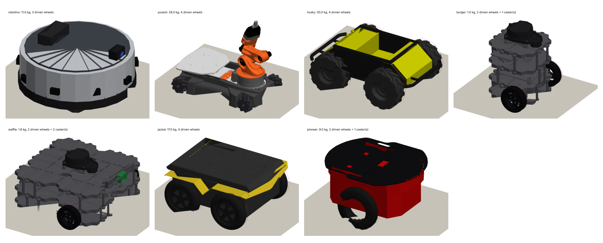

# Роботы: встроенные модели, изменение параметров, свой робот

[English version](../en/ROBOTS.md)

Все роботы идут через один режим ядра `vehicle` (`vehicle_logic.hpp`): колёса любого типа, группы моторов, траектория,
регулятор, одометрия, IMU. Робот — это словарь Python в [`tools/robots.py`](../../tools/robots.py) или JSON-файл в
`configs/robots/`. По нему инструменты пишут INI плагина (`[robot]`, `[wheel k]`, `[motor]`) и модель SDF для Gazebo.



Красные окружности на превью (`python3 tools/robot_preview.py`) — радиусы колёс, с которыми считает модель контакта;
меши только рисуются.

## 1. Встроенные роботы

Обозначения: **П** — паспорт или описание производителя (URDF, руководство, конфиг драйвера); **К** — откалибровано
по записям реального робота; **О** — физически обоснованная оценка.

| робот | масса | колёса | привод | моторы | откуда числа |
|---|---|---|---|---|---|
| `robotino` (Festo Robotino 1.6) | 11 кг | 3 омни, r = 0.04 м, на 0.125 м, 60°/180°/300° | holonomic, diff | 3 × DC, R 5.34 Ом, Ce = kt 0.0501, редуктор 16, η 0.8, I0 0.17 А | геометрия П; центр масс, мотор, регулятор, энкодер (1970 имп./об) и четыре покрытия К |
| `youbot` (база KUKA youBot + сложенный манипулятор) | 28 кг | 4 меканум, r = 0.0475 м, x ±0.228, y ±0.158 | holonomic, diff | 4 × класс maxon EC 45 flat, kt 0.0335, редуктор 25.84, I0 0.20 А | геометрия, редуктор, энкодеры П (`youbot_description`, `youbot-base.cfg`); I0 и трение роликов `mu_rb` = 0.104 К; R, η О |
| `husky` (Clearpath Husky A200) | 50 кг | 4 обычных, r = 0.1651 м, база 0.512, колея 0.571 | diff (бортовой поворот) | 2 (по борту, цепь на два колеса), редуктор 79 | геометрия П (`husky_description`); I0 1.77 А, η 0.713, боковое сцепление шины 0.981 К; R, kt О |
| `rover` (коромысло-тележка MarsSim) | 190 кг | 6 обычных, r = 0.14 м, b = 0.2 м | diff | 6 независимых, редуктор 160 | геометрия из статьи MarsSim; моторы О (в статье их нет) |
| `burger` (TurtleBot3 Burger) | 1.0 кг | 2 обычных r = 0.033 м + шаровая опора | diff | 2 × DYNAMIXEL XL430, редуктор 258.5 | П (ROBOTIS e-Manual); R, Ce, η из данных стопа и холостого хода; центр масс О |
| `waffle` (TurtleBot3 Waffle Pi) | 1.8 кг | 2 обычных r = 0.033 м + 2 шаровые опоры | diff | 2 × DYNAMIXEL XM430, редуктор 212.6 | как Burger |
| `jackal` (Clearpath Jackal) | 17 кг | 4 обычных, r = 0.098 м | diff (бортовой поворот) | 2 (канал на борт) | геометрия, инерции П (`jackal_description`); моторы О |
| `pioneer` (Pioneer 3-DX) | 9 кг | 2 обычных r = 0.0975 м + поворотный ролик | diff | 2 × 12 В, редуктор 38.3 | П (datasheet, ARIA); R, Ce мотора О; центр масс О |

Полный набор чисел с комментарием к каждому источнику — в `tools/robots.py` (по ветке на робота). Числа Robotino и
ровера лежат в `configs/calibrated_params.json` (`robotino.robot`, `robotino.motor`, `rover`).

Husky: по умолчанию стоят значения, определённые по записям реального Husky (I0 = 1.77 А, η = 0.713,
lat_grip = 0.981). До идентификации это были каталожные оценки (I0 = 0.8 А, η = 0.73, lat_grip = 1.0); вернуть их:
`--set motor.I0=0.8 --set motor.eta=0.73 --set wheel.lat_grip=1.0`.

## 2. Как поменять параметры робота

### 2.1 На один прогон: `--set`
```bash
bash scripts/drive.sh --robot husky --set robot.mass=70 --set robot.com_h=0.3     # груз
bash scripts/drive.sh --robot jackal --set motor.gear=30 --set motor.I0=0.4          # другой редуктор
bash scripts/drive.sh --robot burger --set wheel.patch=0.02 --set caster.r=0.008     # все колёса / все опоры
bash scripts/drive.sh --robot youbot --set controller.ky=6 --set imu.gyro_bias=0.01  # регулятор, IMU
```

| цель | что меняет |
|---|---|
| `robot.<ключ>` | ключ робота: `mass`, `com_x`, `com_y`, `com_h`, `Jw`, `encoder_ticks`, `odom_yaw_scale`, `speed`, `accel`, `v_max`, `w_max`, ... |
| `motor.<ключ>` | `R`, `Ce`, `kt`, `gear`, `eta`, `I0`, `w_eps`, `Vmax`, `Vd`, `kp`, `ki`, `ff` |
| `wheel.<ключ>` | тот же ключ у всех колёс: `r`, `b`, `patch`, `mu_rb`, `lat_grip`, `zmax_r`, `gamma_deg`, ... |
| `caster.<ключ>` | тот же ключ у всех опор |
| `controller.<ключ>` | `kp_xy`, `k_yaw`, `kx`, `ky`, `kth`, `v_max`, `w_max`, `rate` |
| `imu.<ключ>` | `rate`, `gyro_sigma`, `gyro_bias`, `gyro_rw`, `acc_sigma`, `acc_bias`, `acc_rw`, `seed` |
| `contact.<ключ>` | опции контакта: `slip_v_eps`, `slip_relax_len`, `slip_max`, ... |
| `body.<ключ>` | контакт корпуса с землёй: `k`, `c` (на точку), `mu` ([PHYSICS §2.7](PHYSICS.md#27-контакт-корпуса-с-землёй-падения-и-опрокидывания)) |
| `<поверхность>.<ключ>` | параметр поверхности ([SURFACES](SURFACES.md)) |

В `robotino.sh` цели — `robot.<ключ>` и `motor.<ключ>` из `configs/calibrated_params.json`, плюс поверхности.

### 2.2 Насовсем: файл робота на основе встроенного
Создайте `configs/robots/<имя>.json` с `"base"` и ключами, которые меняются (шаблон:
[`examples/robots/husky_payload.json`](../../examples/robots/husky_payload.json)):

```json
{
 "base": "husky",
 "mass": 70.0,
 "com": [0.0, 0.0, 0.30],
 "motor": {"gear": 50.0},
 "wheel": {"patch": 0.10},
 "speed": 0.8
}
```

Словари (`motor`, `ctrl`) сливаются по ключам, `wheel` меняет все колёса, любой другой ключ заменяет значение
базового робота. Производный робот сохраняет меши базового. Запуск по имени: `bash scripts/drive.sh --robot husky_heavy`
(файл `configs/robots/husky_heavy.json`) или по пути: `--robot путь/к/robot.json`. `robotino` и `rover` базой быть не
могут (их модели в Gazebo особые); их меняют через `--set` или в `configs/calibrated_params.json`.

## 3. Свой робот: полный файл робота

Скопируйте один из примеров в `configs/robots/<имя>.json` и отредактируйте (разбор по шагам —
[EXAMPLES §3](EXAMPLES.md#3-свой-робот-по-шагам)):

| пример | схема |
|---|---|
| [`examples/robots/my_diffbot.json`](../../examples/robots/my_diffbot.json) | два ведущих колеса + шаровая опора |
| [`examples/robots/my_skidsteer.json`](../../examples/robots/my_skidsteer.json) | четыре колеса, бортовой поворот |

```bash
cp examples/robots/my_skidsteer.json configs/robots/my_rover.json
python3 tools/robot_preview.py --robots my_rover --body --out /tmp/prev   # окружности колёс красным, точки контакта корпуса синим
bash scripts/drive.sh --list                                         # он в списке вместе со встроенными
bash scripts/drive.sh --robot my_rover --engine emulate --traj square:L=3,rc=0.5
bash scripts/drive.sh --robot my_rover --engine harmonic --gui --map slope_10@up
```
Файл робота работает и по пути, без копирования: `--robot examples/robots/my_skidsteer.json`.

### 3.1 Ключи робота
| ключ | обязателен | смысл |
|---|---|---|
| `mass` | да | полная масса, кг |
| `com` | да | центр масс [x, y, h] в системе корпуса, м (h — высота над землёй) |
| `I` | да | инерция корпуса [Ixx, Iyy, Izz] относительно центра масс, кг·м² |
| `Jw` | да | инерция одного ведущего колеса с приведённым ротором (J_ротора·gear² + J_колеса), кг·м² |
| `size` | да | габарит корпуса [длина, ширина, высота], м: ящик столкновений в Gazebo и корпус на картинке, если мешей нет |
| `wheels` | да | список колёс (§3.2) |
| `motor` | да | `R` (Ом), `Ce` (В·с/рад), `kt` (Н·м/А), `gear`, `eta`, `I0` (А), `Vmax` (В), `kp`, `ki` (контур скорости), необязательно `Vd`, `ff`, `w_eps` |
| `drive` | да | `["diff"]` (бортовой / дифференциальный) и/или `"holonomic"` (омни / меканум); первый — по умолчанию |
| `body_off` | нет | центр ящика корпуса [x, y, z] (по умолчанию [0, 0, h центра масс]) |
| `wheel_mass` | нет | масса звена ведущего колеса в Gazebo (по умолчанию 0.5 кг) |
| `encoder_ticks` | нет | импульсов энкодера на оборот вала мотора (по умолчанию 1024) |
| `odom_yaw_scale` | нет | бортовой поворот: 1 / `wheel_separation_multiplier` контроллера ROS diff-drive (по умолчанию 1) |
| `speed`, `accel`, `v_max`, `w_max` | нет | крейсерская скорость и ускорение по умолчанию, ограничения регулятора |
| `map_size`, `map_res` | нет | полуширина и шаг сетки генерируемых карт по умолчанию, м |
| `ctrl` | нет | коэффициенты регулятора пути: `kp_xy`, `k_yaw` (голономный), `kx`, `ky`, `kth` (diff, Канаяма) |
| `chassis` | нет | имя звена корпуса (по умолчанию `base_link`) |

### 3.2 Ключи колеса
| ключ | обязателен | смысл |
|---|---|---|
| `label` | да | короткое имя для логов (`w<label>_...`) |
| `x`, `y` | да | центр колеса в системе корпуса, м |
| `r` | да | радиус, м |
| `type` | да | `standard` (шина), `omni`, `mecanum`, `caster` (пассивная опора) |
| `group` | да | номер мотора (колёса с одинаковым номером делят мотор; у опор −1) |
| `b`, `patch` | нет | ширина протектора и длина пятна на твёрдом, м (по умолчанию `b_contact`, `patch_len` поверхности) |
| `heading_deg` | нет | направление качения при положительном вращении (по умолчанию 0 = вперёд) |
| `gamma_deg` | нет | угол роликов: 90 омни, ±45 меканум (знак — сторона X-схемы) |
| `mu_rb` | нет | трение подшипников роликов этого колеса (заменяет значение поверхности) |
| `lat_grip` | нет | шины: отношение бокового сцепления к продольному (по умолчанию 1) |
| `zmax_r` | нет | предел осадки / r (по умолчанию 0.6) |
| `z` | нет | высота центра колеса (эмулятор), по умолчанию r |
| `link`, `joint` | нет | имена в SDF (по умолчанию `wheel_<label>`, `wheel_<label>_joint`) |
| опоры: `J`, `swivel`, `trail`, `swivel_h`, `mass` | нет | инерция вращения, свободный поворот (1/0), вылет и высота оси поворота, масса опоры |

### 3.3 Что надо знать
* **Модель в Gazebo.** У роботов без мешей корпус рисуется ящиком столкновений, колёса — цилиндрами. Общая модель
  Gazebo ставит оси всех колёс вдоль оси y корпуса, поэтому в Gazebo каждое колесо должно катиться вперёд
  (`heading_deg` = 0): дифференциальная, бортовая и меканум-схемы работают. Схемы с повёрнутыми колёсами (трёхколёсная
  омни-база вроде Robotino) работают в эмуляторе; для Gazebo им нужна своя ветка модели в `tools/robots.py` (см.
  `sdf_model` и модель Robotino в `tools/gz_sdf.py`).
* **Меши.** Чтобы робот выглядел как CAD-модель, добавьте ветку в `visuals()` в `tools/robots.py` со своими мешами в
  `models/meshes/<робот>/` и укажите `"look": "<имя этой ветки>"` в файле робота.
* **Моторы по паспорту.** При напряжении U, скорости холостого хода ω₀ (на выходе), токе стопа I_s и моменте стопа
  M_s на выходе: Ce = kt = U / (ω₀·gear), R = U / I_s, η = M_s / (Ce·gear·I_s).
* **Поверхности** одни на всех роботов. Они откалиброваны на Robotino; поверхности, на которые вы опираетесь, лучше
  проверить на данных своего робота, если они есть (пример — поверхности `_fit` библиотеки для шин).
* **Жёсткость контакта** масштабируется по статической нагрузке на колесо автоматически; `--kn-scale` < 1 делает все
  колёса мягче (шины).

### 3.4 Необязательные ключи файла робота
| ключ | смысл |
|---|---|
| `body` | формы корпуса для контакта с землёй (§3.5); по умолчанию — ящик `size` в точке `body_off` |
| `look` | имя ветки `visuals()` в `tools/robots.py`, чьи меши использует робот |
| `base` | встроенный робот, от которого отталкиваемся (§2.2) |
| `wheel` | вместе с `base`: ключи, которые ставятся всем колёсам |

### 3.5 Форма корпуса для контакта с землёй
Корпус касается земли точками нескольких простых форм ([PHYSICS §2.7](PHYSICS.md#27-контакт-корпуса-с-землёй-падения-и-опрокидывания)).
Их задают в файле робота списком; ящик даёт 26 точек, цилиндр — 26, и каждое колесо (кроме опор) добавляет 4 точки на
своей внешней боковине:
```json
"body": [
  {"box": [0.57, 0.36, 0.10], "at": [0.0, 0.0, 0.08]},
  {"box": [0.16, 0.16, 0.40], "at": [0.175, 0.0, 0.33]},
  {"cyl": [0.05, 0.30], "at": [-0.1, 0.0, 0.45]}
]
```
`box` — [длина, ширина, высота], `cyl` — [радиус, высота] (ось вертикальная), `at` — центр в системе робота. Низ самой
нижней формы держите на высоте реального клиренса: если ниже, корпус будет скрести по кочкам, которые робот в жизни
проходит.

Встроенные роботы:

| робот | формы | клиренс |
|---|---|---|
| robotino | цилиндр r 0.18 м, 0.05–0.17 м | 5 см |
| youbot | ящик базы 0.57 × 0.36 × 0.10 м + ящик сложенного манипулятора до 0.53 м | 3 см |
| husky | ящик 0.99 × 0.57 × 0.25 м (с бамперами) | 13 см |
| rover | ящик 1.15 × 0.85 × 0.45 м на шасси | 47 см |
| burger, waffle | ящик столкновений из описания ROBOTIS | 1 см |
| jackal | ящик 0.42 × 0.31 × 0.18 м | 6 см |
| pioneer | ящик 0.42 × 0.34 × 0.22 м | 5.5 см |

## 4. Модели встроенных роботов в Gazebo

| робот | звенья | вид |
|---|---|---|
| Robotino | `base_link` + 3 колеса | процедурный: корпус, бампер, дека, блок управления, камера, 9 ИК-датчиков, омни-колёса с 2 × 12 роликами |
| youBot | `base_link` + 4 колеса | CAD: корпус, плита, меканум-колёса, манипулятор в сложенной позе |
| Husky | `base_link` + 4 колеса | CAD: корпус, верх, рейка, бамперы, колёса |
| ровер | `chassis` + коромысла + тележки + 6 колёс | процедурный; дифференциал коромысел — часть плагина |
| Burger, Waffle Pi | `base_link` + 2 колеса + шаровые опоры | CAD (ROBOTIS, прорежены), лидар |
| Jackal | `base_link` + 4 колеса | CAD: корпус, крылья, колёса |
| Pioneer 3-DX | `base_link` + 2 колеса + поворотный ролик | CAD: корпус, дека, вилка, колёса |

Меши лежат в `models/meshes/` (источники и лицензии: [`models/meshes/SOURCES.md`](../../models/meshes/SOURCES.md)).
SDF ссылается на них по абсолютным путям, мир пишется заново при каждом запуске, поэтому папка проекта может лежать
где угодно. `--gz-sensors` добавляет в модель штатные IMU, OdometryPublisher и JointStatePublisher Gazebo.

В эмуляторе у ровера жёсткое шасси; коромысла работают только в Gazebo.
